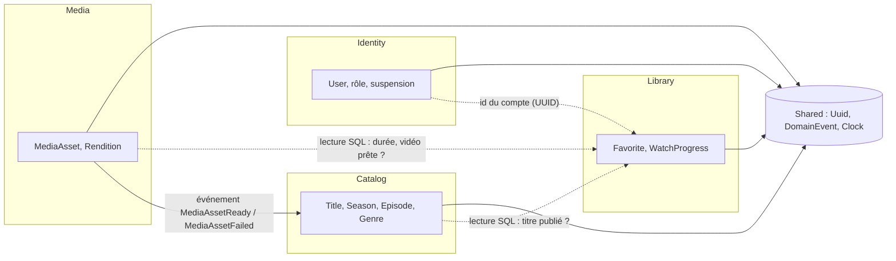
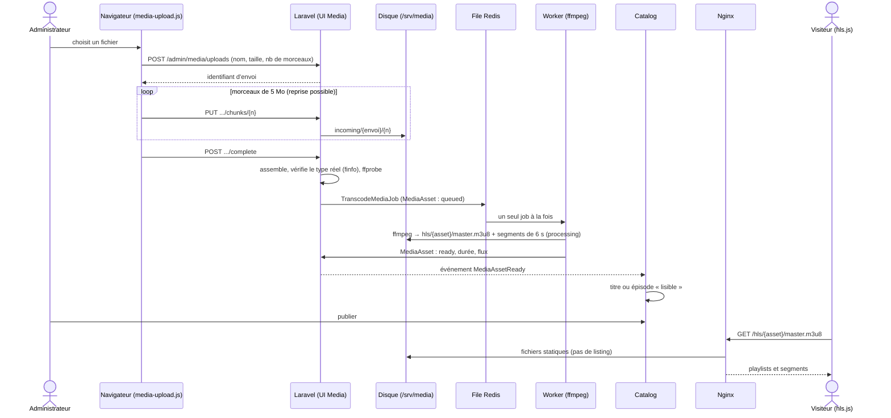

# Architecture

HomeFlix est un monolithe Laravel découpé en **contextes bornés** (DDD) et en **couches** (architecture hexagonale). Le découpage est vérifié automatiquement par `tests/Arch/ArchitectureTest.php`.

## Contextes et dépendances



- **Un contexte ne connaît pas le code d'un autre.** Seuls les événements de domaine traversent la frontière (un test d'architecture interdit tout autre `use`). Quand Catalog doit réagir à une vidéo prête, il écoute `MediaAssetReady` ; Media ne sait pas que Catalog existe.
- **Library lit, sans importer.** Pour savoir si un titre est publié ou quelle est la durée d'une vidéo, elle interroge la base par ses propres adaptateurs de lecture (`DatabaseTitleDirectory`, `DatabaseMediaDirectory`) derrière un port qu'elle définit. Elle réutilise l'identité des autres contextes sous forme d'identifiants (`MemberId`, `TitleRef`, `MediaRef`), pas de leurs classes.
- **Shared** ne contient que le noyau minimal et ne dépend d'aucun contexte.

## Couches d'un contexte

```
src/<Contexte>/
├── Domain/          règles métier pures : agrégats, objets-valeurs, événements. Aucun framework.
├── Application/     cas d'usage (commandes, requêtes, handlers) et ports (interfaces vers l'extérieur).
├── Infrastructure/  adaptateurs : Eloquent, TMDB, ffmpeg, système de fichiers, file Redis.
└── UI/              contrôleurs, composants Livewire, vues Blade, commandes Artisan, routes.
```

Le sens des dépendances va de l'extérieur vers le centre : `UI → Application → Domain`, et `Infrastructure` implémente les ports de `Application` et de `Domain`. Les tests d'architecture vérifient que :

- le domaine n'utilise aucun composant du framework ni aucune couche extérieure ;
- l'application ne dépend ni du framework ni des adaptateurs ;
- l'infrastructure ne dépend pas de l'UI ;
- chaque fichier déclare `strict_types` ;
- un contexte n'utilise des autres que leurs événements de domaine.

L'assemblage (liaison port → adaptateur) est fait dans les `ServiceProvider` de chaque contexte. Le code de `app/` est la couche de composition de Laravel (modèle d'authentification, commande de démonstration qui assemble plusieurs contextes).

**Pourquoi cette organisation ?** Le domaine se teste sans base ni framework (couverture du domaine mesurée en CI, seuil 90 %), un adaptateur se remplace sans toucher aux règles (TMDB, ffmpeg, disque local → CDN, plus tard), et chaque contexte a son vocabulaire (« publier » n'a pas le même sens pour un titre que pour une vidéo).

## Pipeline vidéo (HLS)



États d'un `MediaAsset` : `uploaded → queued → processing → ready | failed`. Seul un `failed` peut être relancé. Un `ready` ne repasse jamais en `processing` (règle du domaine **et** contrainte en base).

Encodage : H.264 (`libx264`, preset `veryfast`, CRF 23), AAC, segments de 6 s, une playlist par qualité (1080p et 720p selon la source) et un `master.m3u8`. Sur ARM sans encodage matériel, tout est logiciel : un seul job à la fois, `nice`, délai maximal de 4 h.

## Reprise de lecture

Le lecteur envoie la position toutes les 10 s (`PUT /progression/{vidéo}`), à chaque pause, à la fin et quand l'onglet se cache. La durée vient du serveur : la position ne peut pas la dépasser (domaine **et** `CHECK` en base). Au-delà de 90 % la vidéo est « terminée » et sort de la liste « Reprendre la lecture » ; pour une série la liste propose le dernier épisode commencé et non terminé.

## Front : Blade, Livewire, Alpine

| Choix | Pourquoi |
|---|---|
| **Blade** (rendu serveur) | Pages de catalogue indexables, aucun build de composants, une seule langue côté serveur : le code reste explicable en entier. Svelte a été écarté : il aurait ajouté une API JSON, un second état à synchroniser et un second langage pour un gain d'interactivité dont le produit n'a pas besoin. |
| **Livewire** | Seulement là où une page doit réagir sans rechargement : recherche en direct (tolérante aux fautes), bouton favori, liste des vidéos en cours de conversion. Pas de WebSocket : la liste se rafraîchit par requêtes périodiques (10 s), et seulement s'il y a une conversion active. |
| **Alpine** | Livré avec Livewire ; sert aux menus (Breeze). Pas de logique métier côté navigateur. |
| **JavaScript natif** | Deux scripts sans framework : envoi par morceaux et lecteur. Leur logique est dans des modules sans dépendance, testés avec le lanceur de tests de Node (39 tests). |

## Sécurité en profondeur

CSRF (jeton sur chaque formulaire et chaque mise à jour Livewire, testé : 419 sans jeton) · XSS (Blade échappe tout ; aucun `{!! !!}` ; `Content-Security-Policy` avec nonce) · SQL (requêtes paramétrées ; les rares `*Raw` n'embarquent aucune entrée utilisateur) · autorisation (rôle vérifié par middleware sur toutes les routes d'administration, testé : 403 pour un simple utilisateur) · secrets (Docker secrets, jamais dans le dépôt ni dans l'environnement des conteneurs) · limites de débit (connexion, TMDB, pages publiques, Livewire, progression) · flux HLS : chemins validés par expression régulière côté SQL et côté JavaScript, pas de listing de dossier.

Limite connue : les flux HLS se devinent par leur URL (identifiant non devinable, mais pas d'authentification) : le visiteur sans compte peut de toute façon regarder un titre publié.
