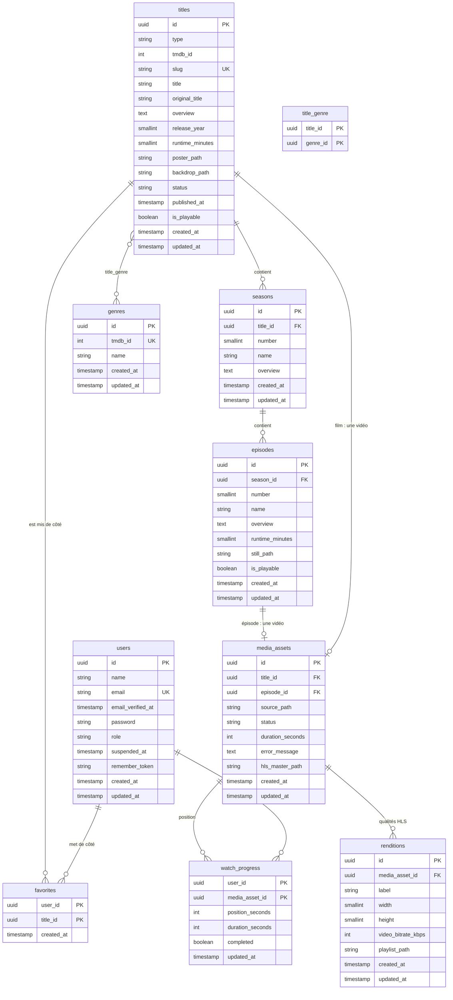

# Modèle de données

PostgreSQL 17. Le schéma ci-dessous est **vérifié par un test** (`tests/Feature/SchemaDocumentationTest.php`) : chaque table et chaque colonne du diagramme doit exister dans la base issue des migrations.

Les tables techniques de Laravel (`sessions`, `cache`, `jobs`, `migrations`…) ne sont pas représentées.

## Contraintes qui portent les règles métier

La base refuse un état invalide même si l'application a un défaut : les règles importantes sont des contraintes `CHECK`, `UNIQUE` ou de clé étrangère, doublées par des tests.

| Table | Contrainte | Règle |
|---|---|---|
| `titles` | `UNIQUE (type, tmdb_id)` | un film ou une série TMDB n'est importé qu'une fois |
| `titles` | `titles_published_has_date` : `(status = 'published') = (published_at IS NOT NULL)` | un titre publié a une date, un brouillon n'en a pas |
| `titles` | `titles_published_movie_playable` | un film publié est lisible |
| `titles` | `titles_series_not_flagged` | une série n'a pas de drapeau `is_playable` : elle est lisible par ses épisodes |
| `titles` | `release_year` entre 1870 et 2100, `runtime_minutes` entre 1 et 10000 | valeurs plausibles |
| `seasons` | `UNIQUE (title_id, number)` | pas deux saisons de même numéro |
| `episodes` | `UNIQUE (season_id, number)` | idem pour les épisodes |
| `media_assets` | `media_assets_target_exactly_one` : `(title_id IS NULL) <> (episode_id IS NULL)` | une vidéo illustre un film **ou** un épisode, jamais les deux, jamais aucun |
| `media_assets` | `UNIQUE (title_id)`, `UNIQUE (episode_id)` | une seule vidéo par film ou épisode |
| `media_assets` | `media_assets_ready_has_stream` | une vidéo prête a une durée et un flux |
| `media_assets` | `media_assets_failed_has_error`, `media_assets_error_only_when_failed` | seule une vidéo en échec porte un message d'erreur, et elle en porte toujours un |
| `media_assets` | `status` dans (`uploaded`, `queued`, `processing`, `ready`, `failed`) | machine d'états |
| `renditions` | `UNIQUE (media_asset_id, label)` | une qualité (720p, 1080p…) par vidéo |
| `favorites` | clé primaire `(user_id, title_id)` | un favori est unique ; l'ajout est idempotent |
| `watch_progress` | clé primaire `(user_id, media_asset_id)` | une progression par membre et par vidéo |
| `watch_progress` | `CHECK (position_seconds <= duration_seconds)` | la position ne dépasse jamais la durée |
| `users` | `users_email_lowercase`, `UNIQUE (email)` | une adresse, une seule graphie |
| `users` | `role` dans (`user`, `admin`) | rôles connus |

Les suppressions sont en cascade du parent vers ses dépendants (titre → saisons → épisodes → vidéo → qualités ; compte → favoris et progressions). Un genre utilisé ne peut pas être supprimé (`ON DELETE RESTRICT` sur `title_genre.genre_id`).

## Choix à défendre

**Identifiants UUID v7.** Générés par l'application (`Shared\Infrastructure\RamseyIdGenerator`), pas par la base : le domaine connaît l'identité d'un agrégat avant de l'enregistrer, ce qui permet de lui rattacher des événements et de tester sans base. La version 7 commence par l'horodatage : les identifiants se rangent dans l'ordre de création, donc les index B-tree ne s'éparpillent pas comme avec un UUID v4 aléatoire. Un UUID ne se devine pas dans une URL (`/admin/titles/{uuid}`), contrairement à `1, 2, 3`.

**`CHECK` plutôt que seulement du code.** Le domaine applique déjà ces règles ; la contrainte est la seconde ligne de défense (un script, une migration ou un autre processus ne peuvent pas écrire un état impossible). Les tests de base vérifient que chaque contrainte refuse bien une ligne invalide.

**`renditions` séparée de `media_assets`.** Un média a un nombre variable de qualités (1080p et 720p, ou seulement 720p si la source est plus petite). Mettre ces colonnes dans `media_assets` obligerait à des colonnes nullables répétées ; une table fille donne une ligne par qualité, contrainte d'unicité à l'appui, et accepte un 480p demain sans migration.

**Films et épisodes dans `media_assets` avec deux clés étrangères et un `CHECK`.** Une seule table de vidéos pour le pipeline (envoi, conversion, lecture), sans table de liaison polymorphe : le `CHECK` « exactement un des deux » et les deux `UNIQUE` gardent l'intégrité référentielle réelle, ce qu'une relation polymorphe (`type` + `id` sans clé étrangère) ne permet pas.

**`pg_trgm` pour la recherche.** L'extension donne la similarité par trigrammes : « interstelar » trouve « Interstellar », « amelie » trouve « Amélie », sans moteur de recherche à héberger. Un index GIN sur `titles.title` et sur `slug` évite le parcours complet. C'est suffisant pour un catalogue de homelab ; un moteur dédié serait disproportionné.

**Un drapeau `is_playable` sur `titles`.** Il évite une jointure sur `media_assets` pour chaque carte du catalogue public. Il est tenu par le domaine (écouteur de l'événement `MediaAssetReady`) et protégé par les contraintes ci-dessus.

**Position de lecture : durée recopiée.** `watch_progress.duration_seconds` copie la durée connue du serveur au moment de l'écriture : la contrainte `position <= durée` se vérifie sans jointure, et la durée ne vient jamais du lecteur.
